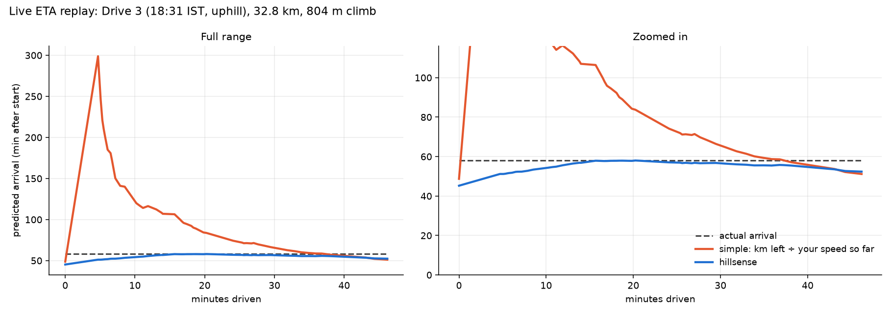
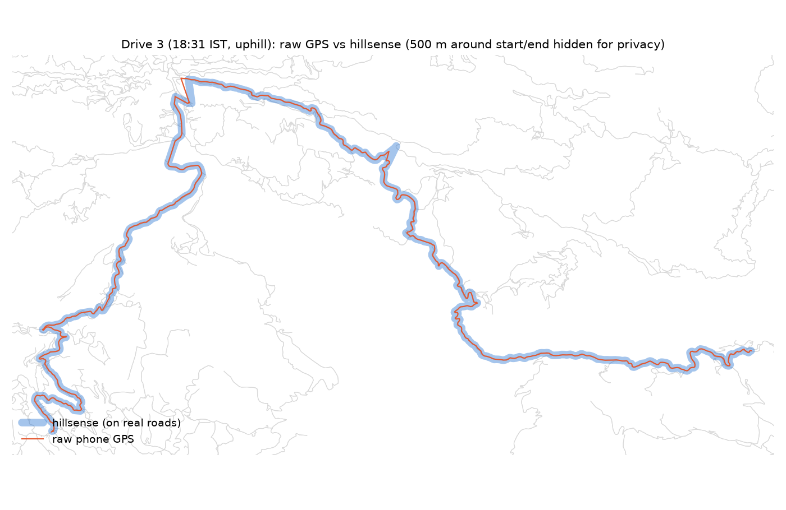
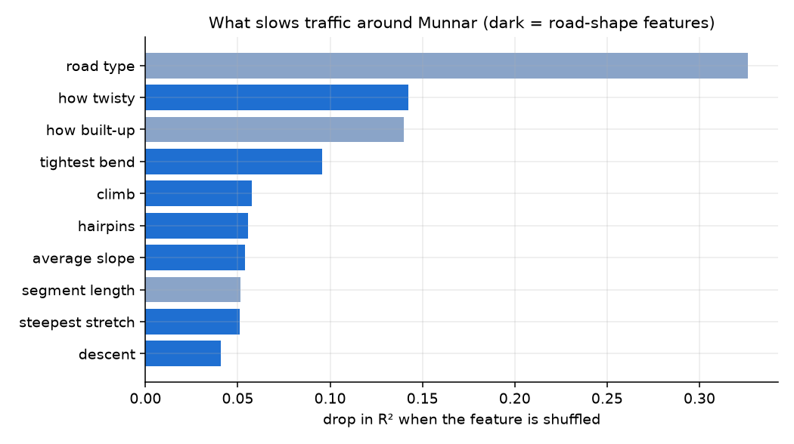

# ⛰️ hillsense

**Steadier GPS tracking and arrival times on hill roads, built from scratch on real drives in Munnar, Kerala.**

> 🔗 **Live demo:** _coming soon_

On a trip to Munnar I drove up the ghat roads to my hotel with Google Maps open. The time and distance left
kept jumping around: at one point the ETA went **up** while I was getting closer, and on the evening
climb it showed *"Cannot seem to find a way there"*. I logged my drives with a GPS app, and the phone's own
log was no better: it said I had driven **55.8 km** on a trip that was really **32.8 km**.

hillsense fixes both halves of that problem:

1. **Tracking**: clean the phone's GPS and snap it onto the real road, even on hairpins whose loops are 30 m apart.
2. **ETA**: predict the time left from the shape of the road ahead (curves, hairpins, climbs, how built-up it is),
   so the arrival time stays steady instead of swinging around.



*Replay of my evening drive up to the hotel (32.8 km, 804 m climb). After every stretch of road, each method
re-estimates the arrival time. The simple method (km left ÷ your speed so far) jumps to 5 hours after a slow start
through town; hillsense stays close to the real arrival time the whole way.*

---

## Results

All numbers come from drives the model **never saw during training**: 5-fold cross-validation **grouped by drive**
on 52 public car drives, plus my own Munnar drives, which were never used for training *or* tuning.

### Live ETA (re-estimated after every stretch, like a nav app)

| Method | Public drives: error in time left | Public drives: avg arrival-time jump per update | My drives: error | My drives: jump |
|---|---|---|---|---|
| Simple: km left ÷ your speed so far | 25.7% | 1.69 min | 73.5% | 5.07 min |
| **hillsense** | **18.4%** | **0.49 min** | **21.1%** | **0.28 min** |

→ **28% lower error and about 3.5× steadier** on held-out public drives. (My own drives are only 2 scorable
drives, so treat that column as an illustration rather than the main result.)

### ETA before the trip starts (median error over the whole drive)

| Method | Median error |
|---|---|
| One average speed for every road | 16.0% |
| One average speed per road type | 18.0% |
| Gradient-boosted trees, no road-shape features | 14.6% |
| **hillsense** (all features) | **14.4%** |

Before the trip, hillsense is only slightly better than one average speed, and that is an honest finding rather
than a failure (see below).

### Tracking

| My drive 3 (evening, uphill) | Distance |
|---|---|
| Raw phone GPS, whole log | 55.8 km |
| **hillsense** (trip detection → Kalman → HMM map-matching) | **32.8 km** |

About 70% of the phone's distance was fake: once I'd parked, the phone indoors kept logging fixes that jumped
hundreds of metres every 10 s – 5 min. Across all my drives, 1,786 of 1,795 thinned points matched onto a road,
with a median distance to the road of 4–7 m.



---

## What I found

- **Curves slow Munnar traffic more than climbs do.** After road type, the model leans most on how twisty the road
  is, how built-up the area is and the tightest bend. Slope matters, but less.
  
- **The driver matters as much as the road.** About **29%** of all speed variation comes down to *which drive* it was
  (driver, vehicle, traffic that day). Average speeds on the same roads ranged from 19 to 48 km/h. No road map can
  know that before you set off, which is why pre-trip ETAs only improve slightly. The real win is live: learn the
  driver's pace as you go, and use the road model for what's still ahead.
- **Simple tables can mislead.** With only my two drives, downhill looked *slower* than uphill. The real reason was
  that my downhill drive went through Munnar town traffic. Munnar sits in a flat valley, so "flat" roads are town
  roads and "steep" roads are open highway. That's why I used a model with all features together, tested on unseen
  drives.

## How it works

```
phone GPX ──► trip detection ──► Kalman filter ──► HMM map-matching ──► road features ──► ETA model
            (drop parked/indoor  (smooth + reject   (snap onto OSM roads,  (slope, curves,     (gradient-boosted
             GPS jitter)          impossible jumps)  Viterbi over hairpins) hairpins, town)     trees, km/h per stretch)
```

| Step | File | Notes |
|---|---|---|
| Load GPX 1.0/1.1, split a day into drives | `hillsense/gpx_loader.py` | phone apps and OpenStreetMap exports use different GPX versions |
| Trip detection | `hillsense/trips.py` | a trip = healthy GPS (≥ 20 fixes/min) **and** moving faster than walking |
| Kalman filter (from scratch) | `hillsense/kalman.py` | constant-velocity model, χ² outlier gating, max-speed gating, gap handling |
| Road network (from scratch) | `hillsense/road_network.py` | reads osmnx GraphML, grid spatial index, Dijkstra |
| HMM map-matching (from scratch) | `hillsense/map_match.py` | Newson & Krumm (2009): Gaussian emissions, route-vs-straight-line transitions, Viterbi, HMM breaks |
| Elevation | `hillsense/elevation.py` | Copernicus DEM GLO-30, bilinear interpolation. Agrees with my phone's altitude to a **4 m** median |
| Road features | `hillsense/road_features.py` | smoothed slope (DEM noise on hillside cuts), curvature, hairpins (> 120° in 60 m), tightest bend |
| Public data | `hillsense/fetch_public.py` | OpenStreetMap GPS traces, polite downloader with retries, **duplicate-upload removal** |
| Training table | `hillsense/dataset.py` | car-drive filter, one row per road-segment pass |
| ETA model + evaluation | `hillsense/eta_model.py` | baselines, grouped CV, held-out test, live-ETA replay |
| Demo | `app.py` | Streamlit + folium |

## Data

| Source | What | Size used |
|---|---|---|
| My phone (Open GPX Tracker, 1 Hz) | 3 drives around Munnar, 22 Oct 2026 | 5,804 points |
| OpenStreetMap public GPS traces | trips around Munnar (77.00–77.22°E, 10.00–10.12°N) | 100 pages → 69 unique traces → **52 car drives** |
| OpenStreetMap roads (via osmnx) | drivable road network | 2,295 junctions, 5,311 segments |
| Copernicus DEM GLO-30 | ground height every ~30 m | 431 × 792 grid |

Training table: **1,758 road-segment passes, 907 km and 32 hours of driving.**

## Pitfalls I hit (and fixed)

- **Duplicate uploads → data leakage.** 28 of the public traces were re-uploads of the same drive (one drive was
  uploaded 7 times). Left in, copies would land in both train and test sets and inflate accuracy. They're removed by
  fingerprinting each trace.
- **"Hour of day" let the model memorise drivers.** Each public drive happens at one time, so the hour acted as an ID
  for the driver. I removed it: cross-validated median error got slightly worse, but generalisation got better.
- **Tuning on the test set.** The one live-ETA setting (how cautiously to learn the driver's pace) was chosen on
  public cross-validation only, never on my own drives.
- **Satellite elevation on hillsides.** The DEM measures ground (and tree canopy) *around* the road, giving fake
  slopes of up to 315%. Smoothing along the road plus a ±35% cap fixed it.
- **Phone GPS indoors.** No filter can tell a fake 800 m jump from a real 800 m drive when fixes are a minute apart.
  Trip detection removes it instead.

## Limitations

- This isn't a Google Maps competitor. Google uses live traffic from millions of phones; hillsense only knows the road
  shape and how *you* have driven so far. The claim is narrower: on these hill roads, road shape gives a more
  accurate and much steadier ETA than going by your average speed so far.
- One region (Munnar), 52 public drives. Some public traces are from 2010–2014.
- Moving time only: stops slower than a crawl (tea breaks, parking) are left out of training and evaluation.

## Run it yourself

```bash
python3.12 -m venv .venv && source .venv/bin/activate
pip install -r requirements.txt scikit-learn osmnx rasterio matplotlib

# 1. road network + elevation (one-off downloads)
python -c "import osmnx as ox; ox.save_graphml(ox.graph_from_bbox(bbox=(77.00, 9.98, 77.22, 10.12), network_type='drive'), 'data/osm/munnar_drive.graphml')"
curl -L -o data/dem/cop30_N10_E077.tif https://copernicus-dem-30m.s3.amazonaws.com/Copernicus_DSM_COG_10_N10_00_E077_00_DEM/Copernicus_DSM_COG_10_N10_00_E077_00_DEM.tif
python -m hillsense.elevation --crop
python -m hillsense.road_features

# 2. public GPS traces, training table, model
python -m hillsense.fetch_public
python -m hillsense.dataset        # put your own GPX in data/raw/ first
python -m hillsense.eta_model

# 3. demo
python -m hillsense.make_demo_data && python -m hillsense.make_figures
streamlit run app.py
```

My raw GPS is not in the repo (privacy). The demo and figures use a trimmed copy that hides 500 m around the start
and end of every drive.

## Credits

- Map data © [OpenStreetMap contributors](https://www.openstreetmap.org/copyright), available under the ODbL.
  Public GPS traces from OpenStreetMap users who shared them as trackable/identifiable.
- Copernicus DEM GLO-30 © DLR e.V. 2010–2014 and © Airbus Defence and Space GmbH 2014–2018, provided under COPERNICUS by
  the European Union and ESA; all rights reserved. Accessed via [AWS Open Data](https://registry.opendata.aws/copernicus-dem/).
- P. Newson and J. Krumm, "Hidden Markov Map Matching Through Noise and Sparseness", ACM SIGSPATIAL 2009.

Built by **Abhipsa Rout** · MIT License
